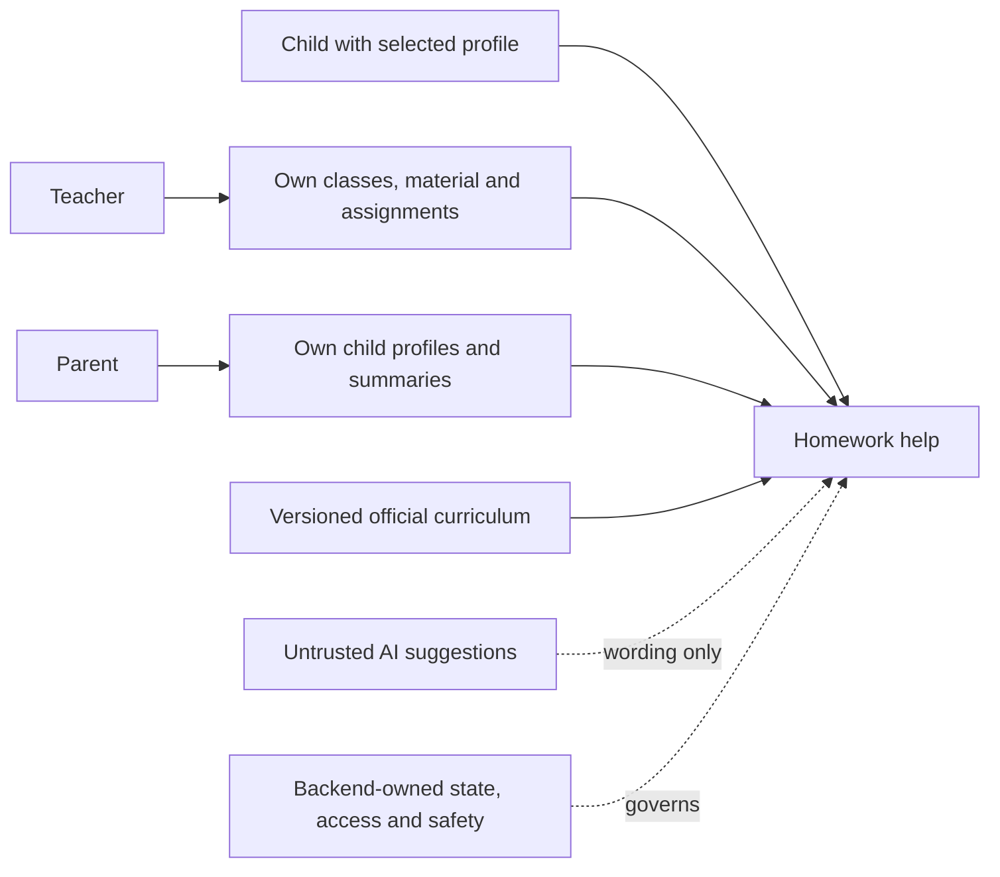
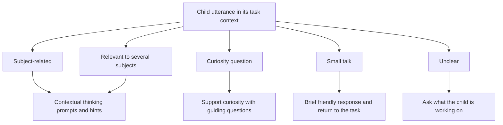
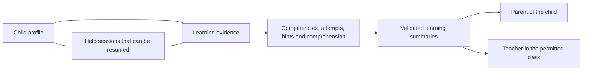
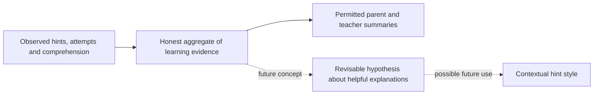
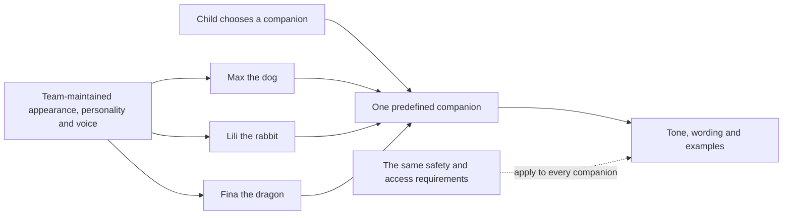
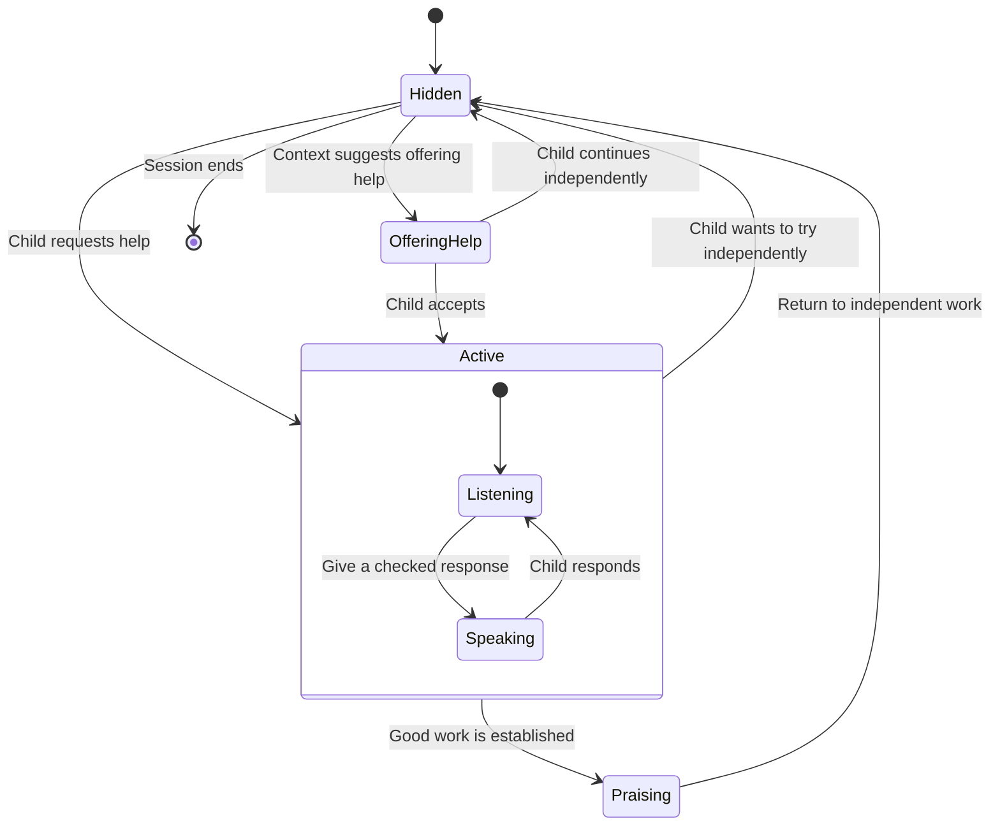
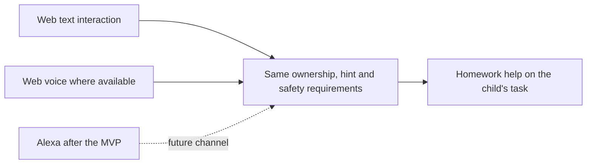

# Product concept and flows

Read the [product vision](vision.md) first. This overview translates the concept sketch dated 2026-10-24 into repository-readable diagrams, adjusted to the subsequently confirmed scope. It describes intended behavior, not an implemented system or a final architecture.

## How to read this document

| Status              | Meaning                                                                                    |
| ------------------- | ------------------------------------------------------------------------------------------ |
| Product requirement | Agreed behavior or constraint from the product vision. Implementation must satisfy it.     |
| Concept proposal    | One possible interaction or representation. Review it against the task before adopting it. |
| Undecided           | No technical choice has been approved. Do not infer one from a diagram.                    |

The diagrams do not mandate modules, tables, an AI processing chain or event sourcing. The technical design of session persistence and the AI processing chain remains undecided. Future ideas must not become MVP acceptance criteria accidentally.

## 1. System responsibilities

**Product requirement:** children work on their own school tasks or teacher assignments. Parents and teachers have scoped access. The backend owns state and validation; AI suggestions are untrusted.

This is a responsibility map. It specifies neither service boundaries nor the order of AI processing steps. Related work: #8, #9, #10, #11, #28, #29, #32, #33 and #35.

## 2. Understanding a child's utterance

**Concept proposal:** distinguish subject help, cross-subject questions, curiosity and small talk. Ambiguity should lead to a friendly clarification rather than a confident but unsupported classification. Curiosity does not authorize a new exercise offering or disclosure of an answer.

The classifier, its data contract, any confidence scores and its relationship to deterministic rules remain undecided. Every output still has to satisfy the product's safety requirements. Related work: #6, #10, #11, #28, #30 and #31.

## 3. Sessions, learning evidence and summaries

**Product requirement:** unfinished help can be resumed. Learning events are deduplicated. Summaries reflect observed help and understanding, not rankings or raw transcripts.

**Undecided:** the authoritative persistence representation and whether session state is stored directly or derived from events. This diagram does not define a database schema or require an immutable event log. Profile fields are limited to those in the vision; interests and parent-defined learning goals are deferred. Related work: #8, #17 and #35.

## 4. Understanding which help works

**Product requirement:** summaries distinguish topics that needed repeated help from understanding supported by a comprehension check. They must not label children by a fixed learning type.

**Concept proposal:** later compare observed outcomes after different explanation styles. Treat any preferred style as a revisable hypothesis, with a default when evidence is insufficient; this is not a requirement to build an adaptive-style engine in the first slice.

Aggregation rules, sample thresholds and adaptation algorithms remain undecided. Interests, emotional inference and parent-defined learning goals are outside the MVP. Related work: #30 and #35.

## 5. Predefined companions

**Product requirement:** Max, Lili and Fina are predefined combinations maintained by the team. The child chooses one complete companion. Persona affects presentation, not safety or answer correctness.

Exact prompt assembly, voice-provider selection and animation assets are implementation decisions. A catalog entry does not authorize a different product policy. Related work: #10, #11, #31, #34 and PR #37.

## 6. Companion presence in the interface

**Concept proposal:** the companion can offer help without taking over, appear when invited, speak or listen, acknowledge good work and withdraw while the child works independently.

**Product requirements:** assistance cannot depend on animation or sound, praise must reflect actual work, and mistakes are not punished. Reduced-motion users need an equivalent interaction. The exact states, trigger thresholds and animation timing are proposals, not an approved state machine. Automatic detection of frustration is outside the MVP. Related work: #12, #30 and #34.

## 7. Consistent requirements across channels

**Product requirement:** displayed and spoken output obey the same product and safety rules. Existing architecture rules keep business behavior independent of a particular UI.

Alexa is a future concept, not a required MVP adapter. This diagram approves no command schema, orchestration sequence or new integration. The storage-off switch and multi-child shared-device behavior are deferred as described in the vision. Related work: #34.

## Relationship to existing work

- [PR #36](https://github.com/MEscape/hort.ai/pull/36) introduced the homework-companion vision. This documentation adds the later confirmed profile and scope decisions on top of it.
- The earlier demo-learning-path proposal in closed PR #26 and the exercise, reward and streak issues #13, #15, #16 and #19 do not define current requirements.
- Personal agent files and external mockups are context, not substitutes for these shared documents. No local PDF path is required to understand the agreed product.
